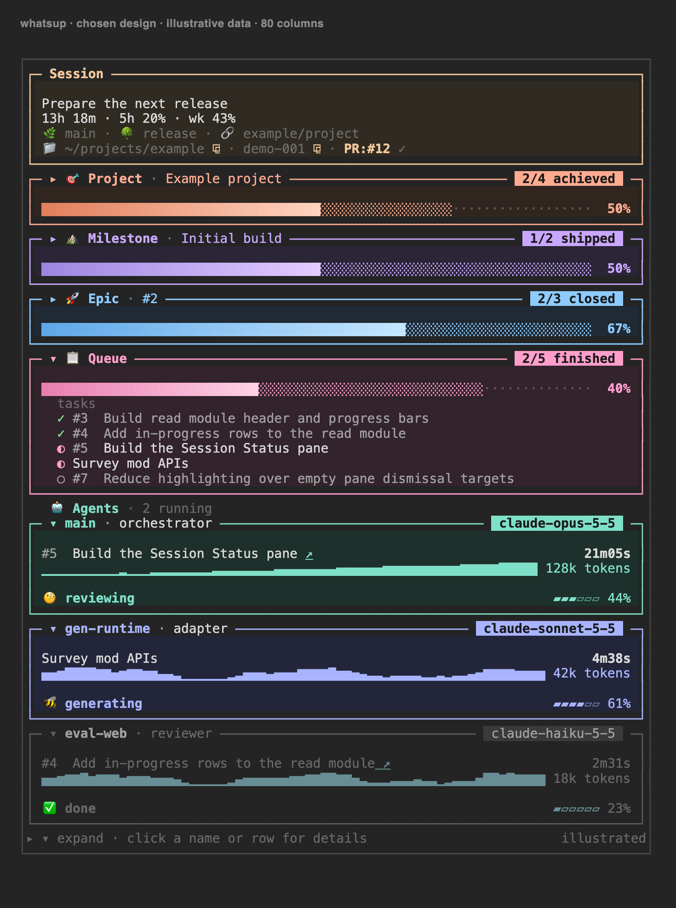

# whatsup

A Claude Code pane showing what your agent session is doing: its scope, progress
sections, session usage and environment, and the activity of its workers.



The image illustrates the chosen design with example data. Each progress section
has its own count and three-state bar. Expand a section to see its items; click a
name or item for a floating detail card. Only the card's `open ↗` action opens a
link. Worker boxes show status, elapsed time, token activity and context fill.

## Installation and configuration

Requires Claude Code with Mods support and **Python 3.10+ available as `python3`**.
The Python reader is bundled; no pip install or separate download is needed.

```bash
claude plugin marketplace add coreyfloyd/whatsup
claude plugin install whatsup@whatsup
```

Start a new session, then run `/whatsup` to open the pane. It opens only when you
ask. See [INSTALLATION.md](INSTALLATION.md) for verification, configuration and
removal.

## How the agent reports

The plugin registers `mcp__whatsup__report` and supplies a short reporting
instruction. One call replaces that session's entire report. A minimum call is:

```json
{"scope":"Prepare the next release"}
```

Sections and workers are optional. The agent supplies ordered items in queued,
active or done states; the pane derives each section's counts. A new session
starts empty. Reports describe work; they grant no permission to do it.
The `github`, `task-list` and `bare` templates guide reporting. An optional
`.whatsup.json` at the repository root overrides the defaults.

## Architecture

The Mod renders session facts and reports. A bundled standard-library Python
reader adds optional GitHub titles, states, membership and destinations. Without
GitHub credentials, reports still work and the pane explains that enrichment is
off. Credentials are resolved from `gh` or `GITHUB_TOKEN`; no credentials belong
in configuration files.

## Documents

- [Interface](INTERFACE.md): exact tool schema, templates, configuration and workers.
- [Read contract](contracts/session-context.md): snapshots, counting and failures.
- [Read module](docs/read-module.md): Python API, authentication and refresh.
- [Vocabulary](CONTEXT.md): terms used throughout the package.
- [Contributing](CONTRIBUTING.md): development and tests.
- [Releasing](RELEASING.md): candidate checks and first-publication procedure.

## Compatibility

This is a Claude Code Mod, requiring a build that exposes the Mods API. The local
contract suite is exercised with Claude Code 2.1.302. On organization-managed
installations, automatic reporting instructions require the plugin to be listed
in managed settings; the report tool remains available. Link opening currently
uses the macOS `open` command. Desktop rendering is covered by engine tests;
manual Desktop integration remains unverified. There is no Codex pane adapter.

## License

Apache 2.0. Author: Corey Floyd. See [LICENSE](LICENSE).
